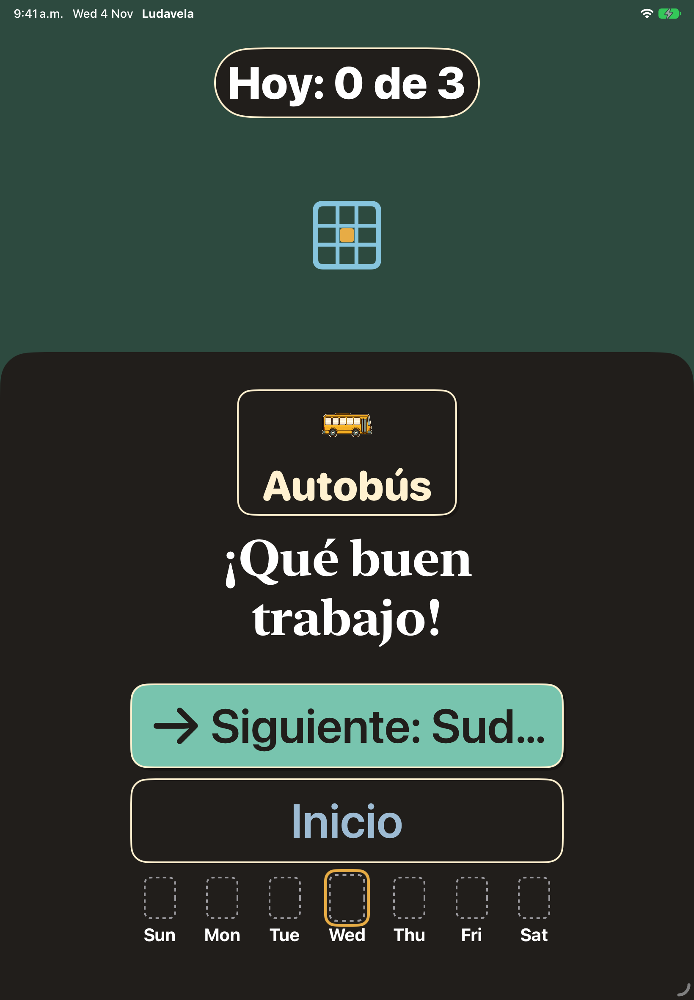
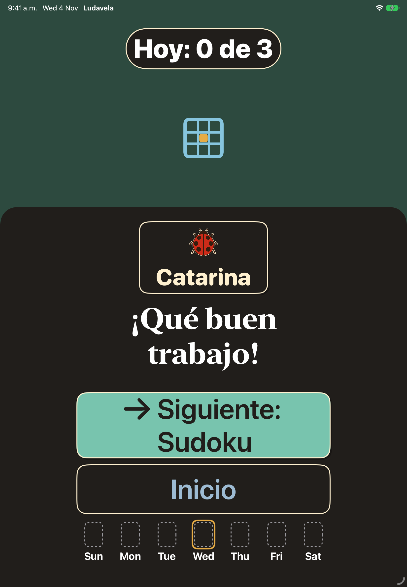

# Evidence for #610: the celebration "Next" button cuts the game name

iPad Air 11-inch (M4) simulator, Spanish, dark, AX5 (`accessibility-extra-extra-extra-large`), mid-day celebration with
today's picture showing and Sudoku next. Captured with a temporary launch fixture in `LudavelaApp.swift` (not committed).

| Before (main) | After (this branch) |
|---|---|
|  |  |

Cause: today's picture card takes height, the stack squeezes the filled button down to its 100pt minimum, and the label
truncates instead of wrapping. `.fixedSize(horizontal: false, vertical: true)` on the whole button keeps its full height;
the picture above gives way, and `fitOrScroll` scrolls if even that is not enough. Putting it on the label alone was tried
first: the text wrapped but overflowed the unchanged button. `RetroButtonStyle` is not changed.
