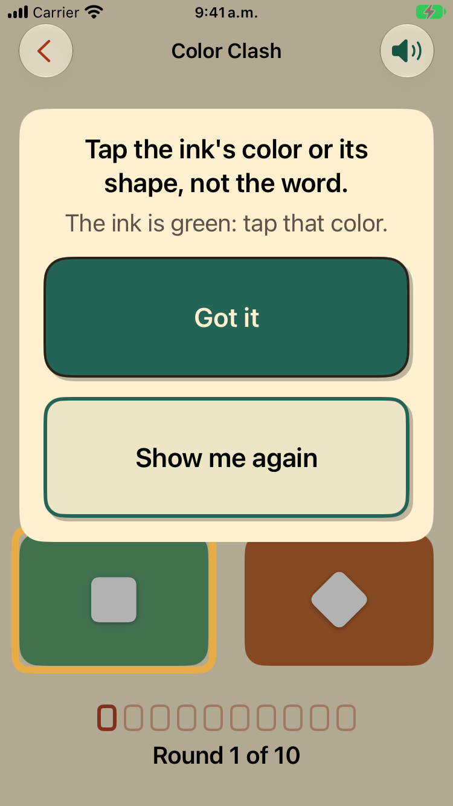
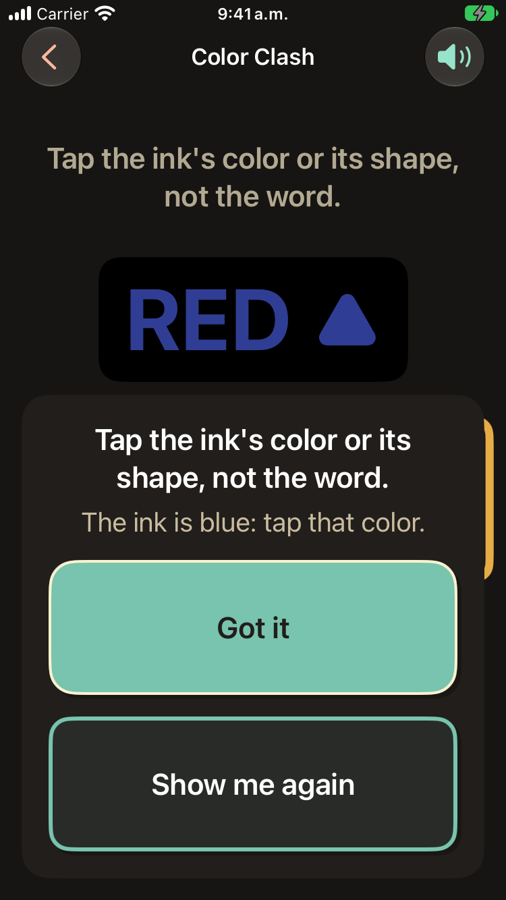
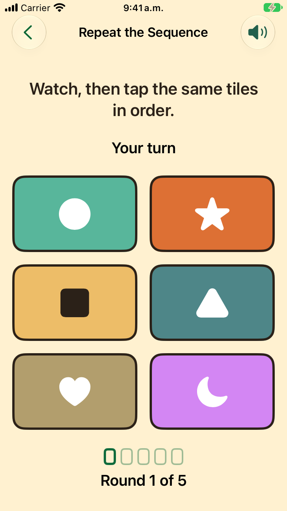
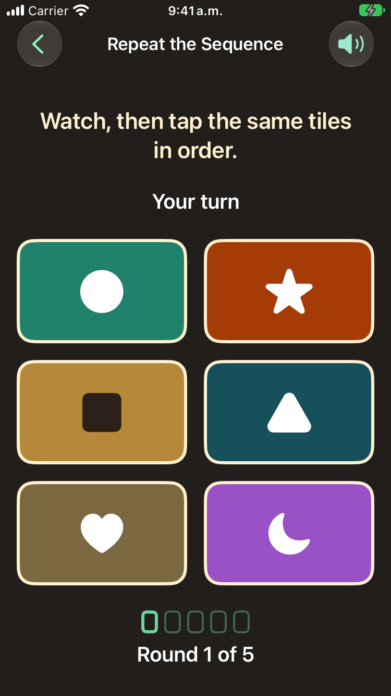

# Colour-blind safe palettes (#629)

iPhone SE (3rd generation) simulator, iOS 27.0, English, default text, 2026-11-04. Each game opened by a
temporary launch fixture (not committed). Simulation: Machado, Oliveira and Fernandes (2009) at
severity 1.0; distance: CIE76 ΔE in Lab. The same check runs as `ColorVisionTests`.

| Palette | Closest pair before | Closest pair after |
|---|---|---|
| Color Clash inks | 5.2 (orange/yellow, protanopia) | 21.4 |
| Repeat tiles, full strength | 3.2 (star/heart, protanopia); 7.3 triangle/sun with typical vision | 20.1 |
| Repeat tiles, resting at 75% on cream / dark | not measured | 18.2 / 18.2 |

Color Clash inks keep about 3:1 or better on the white and black panels the word sits on (yellow
3.2:1 on white, the closest). Repeat tiles other than the amber square keep at least 3:1 under the
white symbol.

These are simulations, not a test with colour-blind players.

| | Light | Dark |
|---|---|---|
| Color Clash |  |  |
| Repeat the Sequence |  |  |
