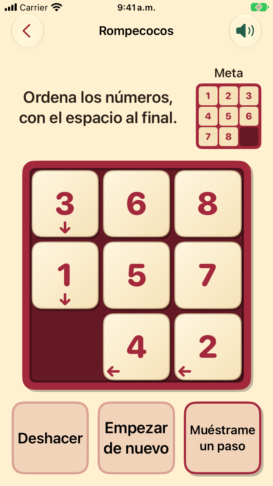
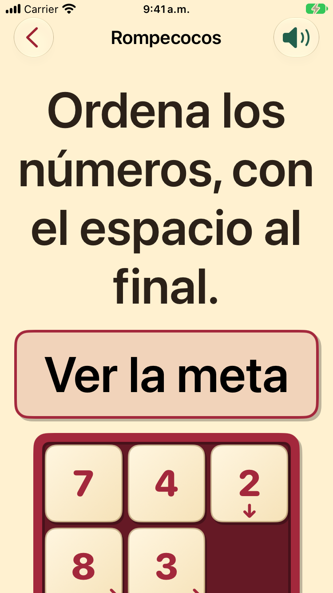
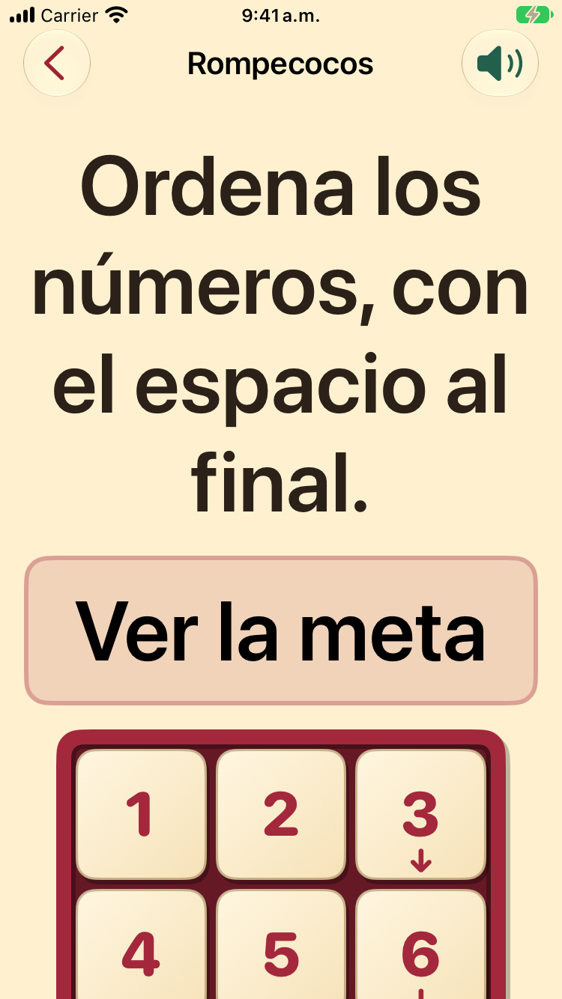
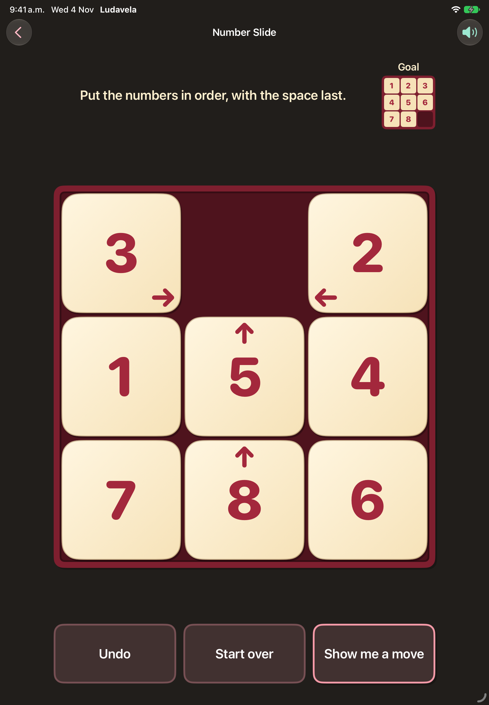

# Number Slide shows the goal (#630)

Simulators, iOS 27.0, 2026-11-04, a 3×3 deal opened by a temporary launch fixture (not committed), the
first-play guide marked seen. The "goal showing" capture holds the goal on with the fixture; in the app
it shows for three seconds after "Ver la meta". It was taken before the arrows were hidden on the goal
board, so it still shows two small arrows.

| | |
|---|---|
| iPhone SE, Spanish, default text: the goal beside the instruction |  |
| iPhone SE, Spanish, AX5: "Ver la meta" instead |  |
| iPhone SE, Spanish, AX5: the goal over the board |  |
| iPad, English, dark |  |
