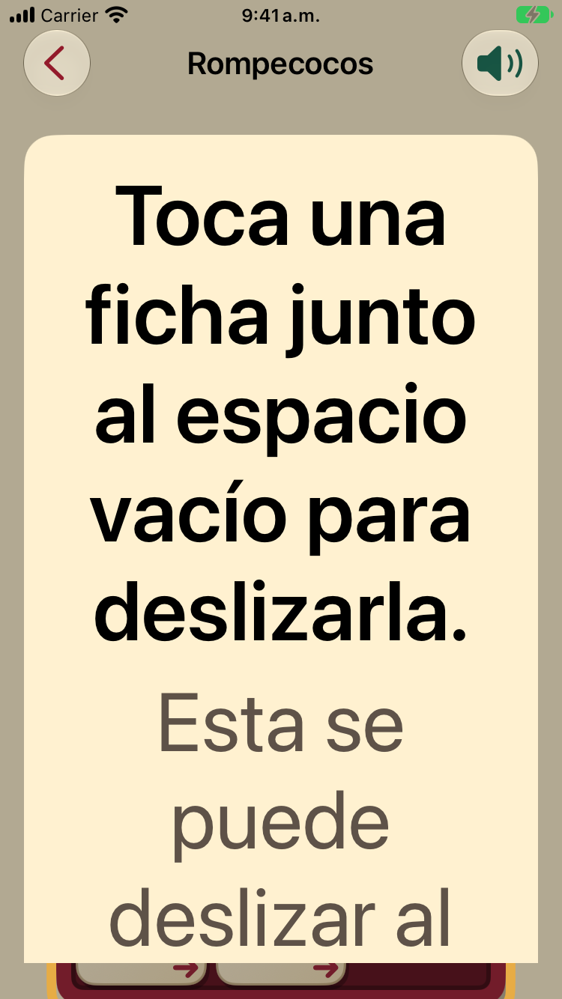
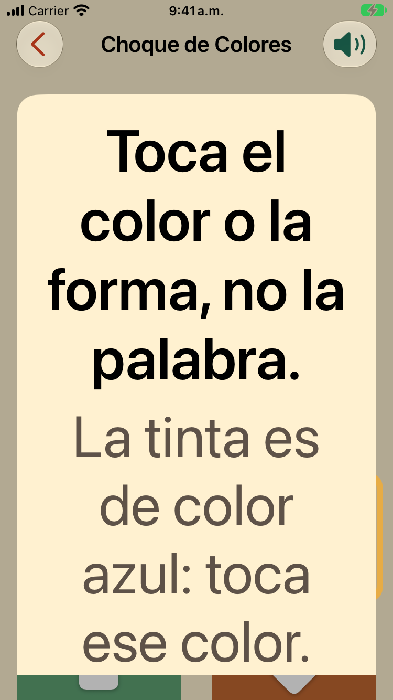
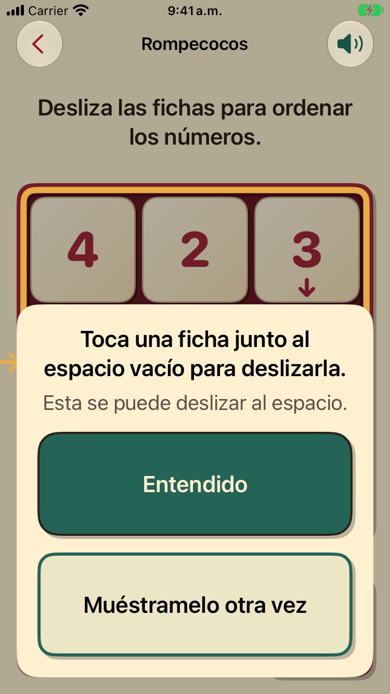

# First-play guide card at the largest text size

iPhone SE (3rd generation) simulator, iOS 27.0, Spanish, 2026-11-04, a temporary launch fixture opening the
game with the guide not yet seen (not committed).

**Before** (`main` at `bec67be`, from the #630 captures): at AX5 the card was cut to "Toca una ficha
junto…", "Esta se pue…" and "Mués- / tramelo ot…".

**After:** the card scrolls when it is taller than the screen, so both lines are whole; "Entendido"
and "Muéstramelo otra vez" are below them, reached by scrolling. At default size nothing changes.

| | |
|---|---|
| Rompecocos, AX5 |  |
| Choque de colores, AX5 |  |
| Rompecocos, default size (unchanged) |  |
